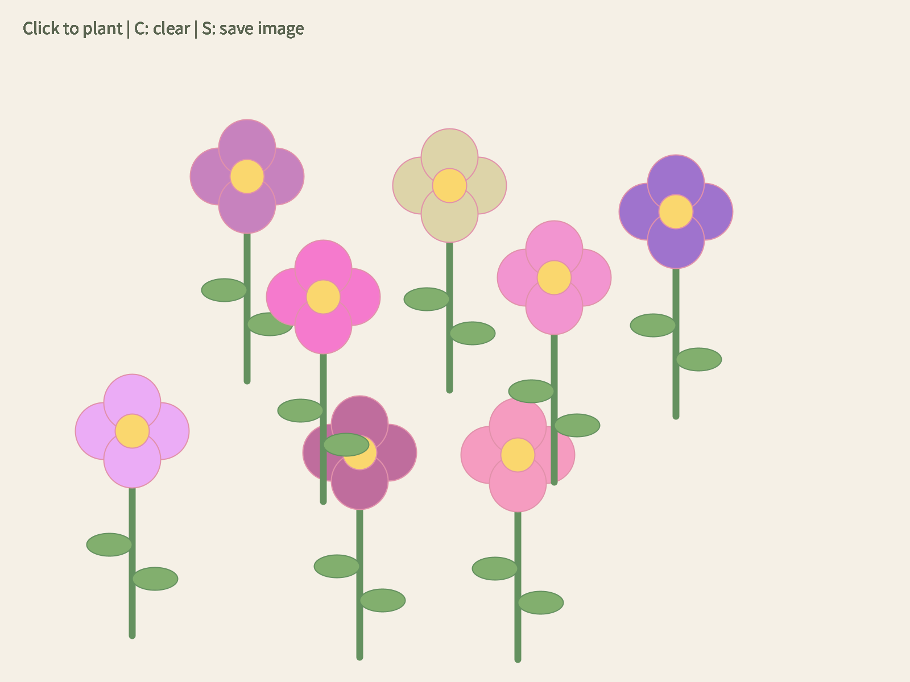

# DigitalGarden
**Creator:** Zhitong Lin  
**Subject:** 52685 Creative Coding — Assessment 2

## Project Overview

Digital Garden is an interactive drawing prototype made in Processing Python Mode. Users click to plant flowers with randomly generated petal colours, press C to clear the garden, and press S to save an image.

The flowers are drawn using code, including lines and ellipses. No external images or sounds are required to run the sketch.

## Requirements

- Processing with Python Mode installed and selected.
- This project was developed using Processing 4.5.6.
- No additional third-party libraries are required.

This is a Processing Python Mode sketch. It does not run directly in a normal Python interpreter or in the GitHub webpage.

## How to Run

1. Click the green Code button on this repository and choose Download ZIP.
2. Extract the ZIP file.
3. Create a folder named `digital_garden_v10`.
4. Place `digital_garden_v10.pyde` and `sketch.properties` inside that folder.
5. Open Processing and select Python Mode.
6. Open `digital_garden_v10.pyde`.
7. Click Run.

## Controls

Click inside the sketch window first so it receives keyboard input.

| Input | Action |
|---|---|
| Mouse click | Plant a flower inside the permitted planting area |
| C or c | Clear all flowers |
| S or s | Save the canvas as a PNG image |

Saved images appear in the sketch folder with names such as `garden-0531.png`. In Processing, choose Sketch > Show Sketch Folder to find them.

Clicks near the canvas edges do not create flowers. This prevents the petals and stems from being cut off.

## Repository Files

- `digital_garden_v10.pyde` — complete prototype source code.
- `sketch.properties` — Processing sketch settings.
- `garden-0531.png`, `garden-0673.png`, `garden-0704.png`, and `garden-0842.png` — example images saved from the running prototype.
- `README.md` — project information and instructions.

The example PNG files demonstrate the output; they are not required to run the program.

## Example Output

## Code Structure

- `setup()` creates the canvas and initial background.
- `draw()` displays the control instructions.
- `mousePressed()` checks planting boundaries and passes mouse coordinates to the drawing function.
- `draw_flower()` draws the stem, leaves, petals and centre.
- `keyPressed()` handles clearing and saving.

## Current Limitations

Flowers remain static after planting. The prototype does not currently support individual flower deletion, custom colour selection, rotation or movement.

## Acknowledgement

Drawing basics were adapted from the class example `the_circle_purple`. This starting point is also acknowledged in the source-code comments.
